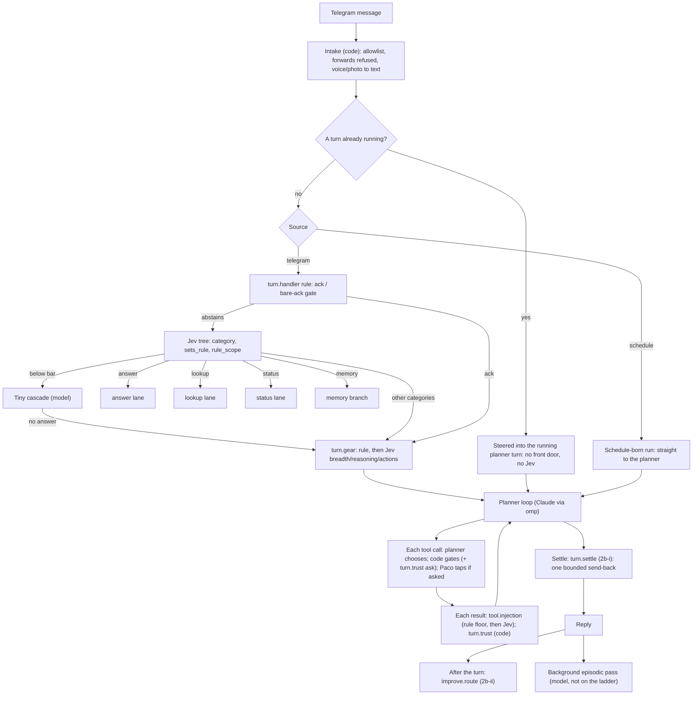

# Decision map: who decides what in a Houge turn

As of 2026-10-20 (decision ladder stages 1 and 2a live; 2b-i built on `feat/ladder-2b-hooks`, not merged; 2b-ii next). Design: [ADR 0029](../decisions/0029-jev-system-one.md),
[ADR 0030](../decisions/0030-decision-ladder.md), [the decision-tree spec](../superpowers/specs/2026-10-06-jev-decision-tree-design.md),
[the decision-ladder spec](../superpowers/specs/2026-10-12-decision-ladder-design.md). Jev details (bars, rows, arming):
[jev-decision-layer.md](jev-decision-layer.md). Update this map whenever an entry, lane or rung changes.

## Deciders

Tried in this order on every registry entry; the first confident answer wins.

| Decider | What it is | Rule |
|---|---|---|
| Code rule | deterministic function | always first; when it answers, nothing else is asked |
| Jev | typed classifier, not generative | decides only when p clears a calibrated bar, else abstains |
| Model rung | one-shot cheap LLM with a closed answer (Tiny cascade, distill) | below Jev |
| Planner | omp tool loop on Claude (Opus 5.5 Default/Thinking, Sonnet 5.5 Fast) | composes between gates; never gates |
| Paco | a tap: approval, Undo, Dig deeper, digest ✅/❌ | taps are also labels |

A lane is not "Jev instead of Claude": Jev only picks the route. The answer and lookup lanes reply with Claude Sonnet
(Fast role) in one shot without tools; the planner is the tool loop. A lane never asks Paco anything, so a category that
needs an approval stays with the planner.

What a Jev or model verdict may cause (ADR 0030 R12): over Paco's own message, an effect that is reversible and
announced (Undo); over tool output, only tightening (withhold, add a tap, send back once), lasting changes as proposals.
Never allow or deny an action.

## The whole turn

## Why a category goes to the planner

Not reasoning depth. Three things send a category to the planner:

1. **Tools in a loop, steps not known in advance** (`research`, `machine_task`). A lane is a fixed recipe: at most one
   search and one compose.
2. **An approval may be needed** (`self_change`, `machine_task`, mail sends, fixing a stored memory, the `fix` route). A lane never asks.
3. **The lane is not built yet** (`schedule`, `wiki`, `mail_calendar`).

Reasoning depth is a separate decision: `turn.gear` turns Jev's `reasoning`, `breadth` and `actions` scores into the
role (Fast = Sonnet, Default = Opus medium, Thinking = Opus high). The lane-or-planner check (`laneBranch`) reads only
`actions` and `breadth`, so a hard question that needs no tools can still run in the answer lane, with the effort raised.
The one exception: "think harder" (认真想) always goes to the planner.

## Categories

Jev's `category` picks one of eleven paths. Any category with `sets_rule` = yes saves first (a rule, a fact or both, decided by `memory.kind`), then its path runs.

| Category | Today | Next | State |
|---|---|---|---|
| `answer` | answer lane (Sonnet composes from the thread); planner if any action is needed | — | built, stage B |
| `lookup` | lookup lane (code query, search through the reader wall) | 2b: a topic recurring 3× in 14 days raises a wiki proposal | built, stage B |
| `research` | planner, Thinking role | whether it becomes a lane: a stage C decision from the ledger | open |
| `memory` | memory lane (its own `memory.kind` call): a rule, a fact or both saved; a fix (`memory_correct`) or nothing handed to the planner | — | built on feat/memory-write (live after Paco's merge and kickstart) |
| `self_change` | planner (`self_diagnose`, `self_write_propose`) | SP4; never a lane (approvals) | SP4 |
| `machine_task` | planner (shell, files behind code gates) | stage 4 gates and standing approvals; never a lane | stage 4 |
| `schedule` | planner (`schedule_task`) | schedule lane (one-shot extract, code validates); 2b schedule proposals | specified, stage C, not built |
| `wiki` | planner (`wiki_build`, `wiki_refine`) | wiki lane; wiki dormant since the omp cutover, 2b checks its tools | specified, stage C, not built |
| `mail_calendar` | planner (`gmail_read`, `google_api`) | SP2 and Jev lane 4 (inbound triage) define its lane | open, SP2 |
| `status` | status lane | — | built, lane 1 |
| `other` | planner, Default role | stays the fall-through | final |

The `memory.kind` golden set has no `fix` items: Jev does not clear 0.85 on `fix` (first-option bias toward `other`; live gate
2026-10-18, 3 of 3 runs), so a fix request falls below the bar to the distill and the planner (`memory_correct`).

## Inside the planner

| Decision | Decider | Effect |
|---|---|---|
| Which tool, what input, what to reply | planner model | composes; not a registry entry by design (ADR 0013) |
| Tool allowed? asks first? | code, then Paco | contract allow-list and approval gates; registry in stage 4 |
| `turn.trust` (clean / untrusted / hostile) | code, locked | untrusted: `lesson_write`, `schedule_task`, `self_write_propose`, `skill_author` ask; hostile: every write asks |
| `tool.shell_netread` | code | feeds the trust level |
| `tool.injection` | rule floor, then Jev | pass / frame / withhold; tighten only (since 2b-i also on omp's built-in `read`, with a whole-text floor if the judge is late) |
| `turn.settle` (2b-i, built, not merged) | rule, then Jev | send back once, or settle |

## Registry entries

| Entry | Rungs | Reads | May cause | State |
|---|---|---|---|---|
| `turn.handler` | ack rule → Jev tree → Tiny → planner | Paco | lane choice; save-first rule with Undo | live, stage 1 |
| `turn.gear` | rule → Jev scores → Default | Paco | planner role | live, stage 1 |
| `memory.kind` | Jev `memory_kind`, its own request (provisional bar 0.85, armed at ship) → distill → other | Paco | write a lesson and/or fact, an Undo per item; hand a fix/nothing to the planner | built on feat/memory-write (live after Paco's merge and kickstart) |
| `tool.injection` | floor → Jev → pass | tool | tighten only; 2b-i adds built-in `read` as a source (judged inside omp's `tool_result` hook) | live, 2a; `read` source built on feat/ladder-2b-hooks |
| `turn.trust` | max rule (locked) | tool | adds taps | live, 2a |
| `tool.shell_netread` | patterns | tool | trust level | live, 2a |
| `turn.settle` | rule (guards incl. `pass_errored`, then claims and todo checks; the delivered reply is audited) → Jev (four noul questions, per-question provisional bars 0.6/0.8/0.7/0.7) → settle | mixed | one bounded send-back through omp's `session_stop`; a Jev send-back also asks on writes for the rest of the turn (`settleAsk`) | built on feat/ladder-2b-hooks (live after Paco's merge and kickstart) |
| `improve.route` | code → Jev → Tiny → nothing | mixed | code: lesson with Undo, pending skill; Jev/Tiny: proposals | 2b-ii (next; proposal surface open) |
| intake, context, supervision, settle families | migrated as they are | — | unchanged | stage 3 |
| `tool.policy`, `tool.shell_class`, `tool.path`, `approval.standing`, … | migrated; standing approvals | — | gates | stage 4 |

## Paths that skip the ladder

| Path | What decides instead | Where it gets fixed |
|---|---|---|
| A message sent while a turn runs (steered) | only the planner model; a memory save treats the newest steered message as its instruction (spec 2026-10-15 §4) | stage 3 intake |
| Schedule-born runs | the planner, by design (a schedule goal is not Paco speaking) | intended |
| Background episodic pass | a model writes facts with no registry entry; it skips any run that explicitly saved (`memory_save_triggers`) | open; not scheduled |
