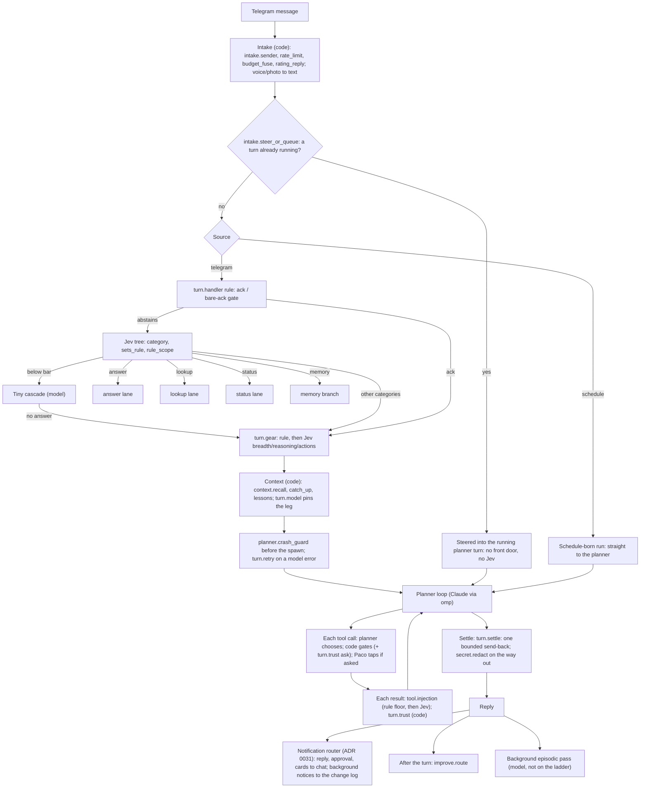

# Decision map: who decides what in a Houge turn

As of 2026-11-05. The registry below is the live list; the build queue is in `tasks/todo.md`. Design: [ADR 0033](../decisions/0033-jev-system-one-consolidated.md),
[ADR 0034](../decisions/0034-decision-ladder-consolidated.md), [ADR 0031](../decisions/0031-chat-carries-what-needs-paco.md) (where a decision's notice goes), [the decision-tree spec](../superpowers/specs/2026-10-06-jev-decision-tree-design.md),
[the decision-ladder spec](../superpowers/specs/2026-10-12-decision-ladder-design.md). Jev details (bars, rows, arming):
[jev-decision-layer.md](jev-decision-layer.md). Update this map whenever an entry, lane or rung changes (re-read it, do not only append).

## Deciders

Tried in this order on every registry entry; the first confident answer wins.

| Decider | What it is | Rule |
|---|---|---|
| Code rule | deterministic function | always first; when it answers, nothing else is asked |
| Jev | typed classifier, not generative | decides only when p clears a calibrated bar, else abstains |
| Model rung | one-shot cheap LLM with a closed answer (Tiny cascade, distill) | below Jev |
| Planner | omp tool loop on Claude (the newest Opus tier head for Default and Thinking, the newest Sonnet head for Fast) | composes between gates; never gates |
| Paco | a tap: approval, Undo, Dig deeper, Accept on a card | taps are also labels |

A lane is not "Jev instead of Claude": Jev only picks the route. The answer and lookup lanes reply with Claude Sonnet
(Fast role) in one shot without tools; the planner is the tool loop. A lane never asks Paco anything, so a category that
needs an approval stays with the planner.

What a Jev or model verdict may cause (ADR 0034 2.1 to 2.3, R12): over Paco's own message, an effect that is reversible and
announced (Undo); over tool output, only tightening (withhold, add a tap, send back once), lasting changes as proposals.
Never allow or deny an action.

Where a decision's notice goes (ADR 0031): a proactive message reaches chat only if Paco must act, his answers or schedules are
affected now, or a locked rule says so. Improvement cards, approval cards and Undo cards are chat topics; applied improvements and standing-grant ends are change-log rows. Decision-health
incidents (`decision_fallback`, `decision_record_failed` and the like), model changes and routine Jev notices go to the change
log, read with `/changes`. `INCIDENT_ROUTE` in `src/run/incident-route.ts` names the route of each incident kind.

## The whole turn

## Why a category goes to the planner

Not reasoning depth. Three things send a category to the planner:

1. **Tools in a loop, steps not known in advance** (`research`, `machine_task`). A lane is a fixed recipe: at most one
   search and one compose.
2. **An approval may be needed** (`self_change`, `machine_task`, mail sends, fixing a stored memory, the `fix` route). A lane never asks.
3. **The lane is not built yet** (`schedule`, `wiki`, `mail_calendar`).

Reasoning depth is a separate decision: `turn.gear` turns Jev's `reasoning`, `breadth` and `actions` scores into the
role (Fast = Sonnet, Default = Opus medium, Thinking = Opus high). The lane-or-planner check (`laneBranch`) reads only
`actions` and `breadth`, so a hard question that needs no tools can still run in the answer lane, with the effort raised.
The one exception: "think harder" (认真想) always goes to the planner.

## Categories

Jev's `category` picks one of eleven paths. Any category with `sets_rule` = yes saves first (a rule, a fact or both, decided by `memory.kind`), then its path runs.

| Category | Today | Next | State |
|---|---|---|---|
| `answer` | answer lane (Sonnet composes from the thread); planner if any action is needed | — | built, stage B |
| `lookup` | lookup lane (code query, search through the reader wall) | `improve.route`: a topic recurring 3× in 14 days raises a knowledge proposal | built, stage B |
| `research` | planner, Thinking role | whether it becomes a lane: a stage C decision from the ledger | open |
| `memory` | memory lane (its own `memory.kind` call): a rule, a fact or both saved; a fix (`memory_correct`) or nothing handed to the planner | — | built, live |
| `self_change` | planner (`self_diagnose`, `self_write_propose`) | SP4; never a lane (approvals) | SP4 |
| `machine_task` | planner (shell, files behind the `tool.*` gates; repeated approved commands run under a standing approval) | never a lane | built, live |
| `schedule` | planner (`schedule_task`) | schedule lane (one-shot extract, code validates); `improve.route` schedule proposals | specified, stage C, not built |
| `wiki` | planner (`wiki_build`, `wiki_refine`) | wiki lane; wiki dormant since the omp cutover | specified, stage C, not built |
| `mail_calendar` | planner (`gmail_read`, `google_api`) | SP2 and Jev lane 4 (inbound triage) define its lane | open, SP2 |
| `status` | status lane | — | built, lane 1 |
| `other` | planner, Default role | stays the fall-through | final |

The `memory.kind` golden set has no `fix` items: Jev does not clear 0.85 on `fix` (first-option bias toward `other`; live gate
2026-10-18, 3 of 3 runs), so a fix request falls below the bar to the distill and the planner (`memory_correct`).

## Inside the planner

| Decision | Decider | Effect |
|---|---|---|
| Which tool, what input, what to reply | planner model | composes; not a registry entry by design (ADR 0013) |
| Tool allowed? asks first? | code, then Paco | contract allow-list and approval gates (`tool.policy`, `tool.shell_class`, `tool.path`, `tool.manifest`, `tool.budget`, `approval.bind`); a standing approval can stand in for the tap |
| `turn.trust` (clean / untrusted / hostile) | code, locked | untrusted: `lesson_write`, `schedule_task`, `self_write_propose`, `skill_author` ask; hostile: every write asks |
| `tool.shell_netread` | code | feeds the trust level |
| `tool.injection` | rule floor, then Jev | pass / frame / withhold; tighten only (also on omp's built-in `read`, with a whole-text floor if the judge is late) |
| `turn.settle` | rule, then Jev | send back once, or settle |

## Registry entries

Every entry in `REGISTRY` (`src/decisions/registry.ts`), in registration order. A parity test checks the ids below against the registry.
Rungs run left to right; "code rule" is a single deterministic function. Locked entries never move and have no off switch.

| Entry | Rungs | Reads | May cause | State |
|---|---|---|---|---|
| `turn.handler` | ack rule → Jev tree → Tiny cascade → planner | Paco | lane choice (answer, lookup, memory, status) or the planner; save-first rule with Undo | live |
| `turn.gear` | rule → Jev scores → Default | Paco | planner role (Fast, Default, Thinking) | live |
| `tool.injection` | floor → Jev → pass | tool | tighten only: pass, frame or withhold a tool result (also omp's built-in `read`) | live |
| `tool.shell_netread` | patterns | tool | feeds the trust level | live |
| `turn.trust` | max rule (locked) | tool | adds taps (untrusted, hostile) | live, locked |
| `memory.kind` | Jev `memory_kind` (provisional bar 0.85) → distill → other | Paco | write a lesson and/or fact, an Undo per item; hand a fix or nothing to the planner | live |
| `turn.settle` | rule (guards incl. `pass_errored`, then claims and todo checks; the delivered reply is audited) → Jev (four questions, per-question provisional bars) → settle | mixed | one bounded send-back through omp's `session_stop`; a Jev send-back also asks on writes for the rest of the turn | live |
| `improve.route` | rule (stale, stated rule, recurrence, expiry pattern, `review_bad`) → Jev `improve_target` → Tiny pick → nothing | mixed (`pacoWordsOnly: autoApplies`) | code: the skill-authoring job into `_pending`, and a lesson/fact from a correction Paco typed, applied with a `/changes` line; Jev/Tiny: proposals as cards (schedule, tool gap, ladder; lesson/fact from any other correction); knowledge recorded only (R5) | live |
| `tool.shell_class` | code rule | tool | classifies a shell command: plain, external write (asks) or destructive (asks) | live |
| `tool.path` | code rule | tool | blocks a path the file floor denies | live, locked |
| `selfwrite.guard` | code rule | tool | blocks a self-write that touches the protected surface | live, locked |
| `fetch.ssrf` | code rule | tool | blocks a fetch the SSRF gate refuses | live, locked |
| `tool.policy` | code rule | tool | allow, require approval or deny a tool call (standing approvals live in its rule) | live |
| `tool.manifest` | code rule | tool | include or omit a tool in the manifest | live |
| `tool.budget` | code rule | tool | stops a run whose tool budget is spent | live |
| `tool.wall` | code rule | tool | whether a tool result crosses the read wall to the reader | live, locked |
| `reader.family` | code rule | tool | primary reader or the fallback reader family | live |
| `posture.kill` | code rule | tool | refuses work while the kill switch is armed | live, locked |
| `approval.bind` | code rule | tool | binds an approved row to one exact action, owner and requester | live, locked |
| `secret.redact` | code rule | tool | masks a known secret value in an outbound report | live, locked |
| `memory.lesson_admit` | code rule | mixed | admits or refuses a rule or fact save | live |
| `schedule.admit` | code rule | tool | admits, dedupes or refuses a schedule create, update or cancel | live |
| `memory.correct_preflight` | code rule | tool | allows or refuses a memory retire or correction by trust limits | live |
| `intake.rate_limit` | code rule | tool | allows or rate-limits a Telegram command | live |
| `intake.rating_reply` | code rule | Paco | consumes a bare rating digit, forwards a comment, or lets the ask lapse | live |
| `intake.budget_fuse` | code rule | tool | admits a new run or refuses it when a rolling 24 h cap is hit | live, locked |
| `intake.sender` | code rule | tool | allows or denies a sender and chat by the allowlist | live, locked |
| `turn.contract` | code rule | tool | compiles the task contract, restricts a schedule-born turn, or refuses | live |
| `intake.bare_ack` | code rule | Paco | nudges instead of treating a bare acknowledgement as an answer while an approval card waits | live, locked |
| `intake.steer_or_queue` | code rule | tool | steer into the live turn, wait behind it, or queue as its own turn | live |
| `planner.crash_guard` | code rule | tool | refuses a spawn while the planner is crash-looping | live |
| `turn.retry` | code rule | tool | move to the next model leg, or fail the turn | live |
| `context.recall` | code rule | mixed | which retrieved facts and wiki pages enter the [context] block | live |
| `context.catch_up` | code rule | mixed | whether the prompt carries the lane replies Paco got since the planner last ran | live |
| `context.lessons` | code rule | tool | full, capped or no lessons in the system prompt under the char cap | live |
| `turn.clarify_cap` | code rule | tool | caps consecutive clarifying questions | live |
| `lookup.rewrite` | code rule | mixed | search a rewritten query or the bare message | live |
| `lookup.thin` | code rule | tool | fetch more of the top list when the first read left the objective unanswered | live |
| `turn.model` | code rule | tool | which leg of the role the planner is pinned to | live |

## Paths that skip the ladder

| Path | What decides instead | Where it gets fixed |
|---|---|---|
| A message sent while a turn runs (steered) | only the planner model, but `intake.steer_or_queue` records the steer, wait or queue decision; a memory save treats the newest steered message as its instruction (spec 2026-10-15 §4) | intended |
| Schedule-born runs | the planner, by design (a schedule goal is not Paco speaking) | intended |
| Background episodic pass | a model writes facts with no registry entry; it skips any run that explicitly saved (`memory_save_triggers`) | open; not scheduled |
