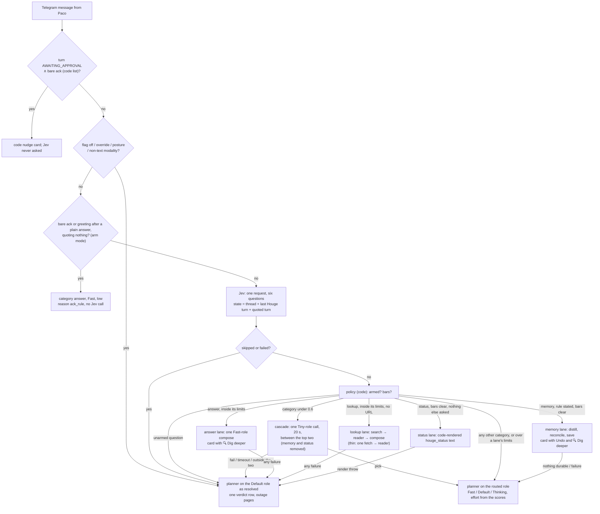

# Jev decision layer (ADR 0029)

Reference for the System One layer as of the stage B lanes and the decision ladder's stage 1: where Jev sits, how a turn is routed, how to read
what it logged, how to arm it and how to roll it back. Design: [ADR 0029](../decisions/0029-jev-system-one.md) and [ADR 0030](../decisions/0030-decision-ladder.md) and
[the decision-tree spec](../superpowers/specs/2026-10-06-jev-decision-tree-design.md) (Rev 9) and [the stage B spec](../superpowers/specs/2026-10-10-jev-tree-stage-b-design.md) (Rev 5). Flags, events, tables and
the CLI: [configuration.md](configuration.md#jev-system-one-adr-0029); model roles:
[configuration.md § Model roles](configuration.md#model-roles). Whole-turn map of every decider and category:
[decision-map.md](decision-map.md). Stages A and B are built; the `schedule` and `wiki` lanes (stage C) are specified, not built.

Jev answers typed questions and cannot generate text. **Code** applies every bar and falls through to the Default role on
any doubt; the **models** compose inside whichever lane or role code picked. Jev may add caution, never remove it, and
never gates an action.

## Decision flow

Every Telegram text turn passes one decision point: state, then six questions in one Jev request, then a pure policy.

A lane is a handler whose control flow is code (one one-shot compose at most). Any lane failure falls through to the
planner; the planner is the floor. Stage B has four lanes: memory, status, answer and lookup. Every lane card ends with 🔍 Dig deeper, which re-runs the
message on the planner.

## The decision ladder

Since ADR 0030 this decision point is the registry entry `turn.handler` (`src/decisions/entries/turn-handler.ts`),
walked by the ladder runner (`src/decisions/decide.ts`):

| Rung | What it is | When it decides | Recorded as |
|---|---|---|---|
| rule `gate` | flag off, override, posture, non-text, no turn state, then the ack rule (arm mode only) | one of those holds | `rung rule`, `reason_code` = the skip reason (`disabled`, `override`, …, `ack_rule`) |
| Jev `tree` | the six-question call and the pure policy above | the policy routes (any lane or the planner) | `rung system_one`, `p` = the category's top probability, `reason_code` = the route reason |
| model `cascade` | the Tiny pick between Jev's top two | the tree went below the choice bar and the pick is one of the two | `rung model`, `reason_code` `cascade` |
| fail | the planner | nothing answered (Jev skipped, cascade failed) | `rung fail`, `fallback_reason` = `timeout` / `outage` / `parse` / `threw` / `budget`, `fallback_rung` = the rung that failed |

(The Jev rung is stored and queried as `system_one` in `decisions.rung`; in prose it is Jev.)

Every `turn.handler` decision is recorded (`decisions` row) in the same transaction as the turn's `jev_verdicts` row
(`decision_id`) and its `jev_decisions` rows (`ladder_decision_id`), all linked; a turn lost before it settles writes none.
`turn.gear` records the route's role from the same call (rung `system_one` when the gear questions were armed and applied, else
`rule`). The entry declares what each verdict causes (ADR 0030 decision 4, R12): the status card is a reversible reply;
`answer`, `lookup`, `memory` and `planner` may save a lesson first on a confident `sets_rule`, and every such automatic save
is announced on the memory card with ↩️ Undo — on the lane card itself, as the memory lane's reply, or as a separate
Undo-only card on the planner path (Paco, 2026-10-12). Whatever the route, an automatic lesson save shows the memory card
with Undo. `HOUGE_JEV_TRIAGE_ENABLED=shadow` runs the Jev and cascade
rungs in shadow: asked and recorded (`armed_mode shadow`), never applied. Stage 1 changed no routing: the pinned
characterisation tests (`tests/core/turn-handler-pin.test.ts`) and the P6 dual run (`scripts/live-gate-decisions-parity.mjs`)
compare every persisted column with the pre-ladder build.

When a handler falls back after the ladder decided (a lane that falls through to the planner, a card that fails to render), the `decisions` row keeps the ladder's verdict: it records what the ladder decided, not what the handler then did. The `jev_verdicts` row (`handler`, e.g. `fallthrough:<why>`) carries the handler's outcome.

The daily decision digest (`HOUGE_DECISION_DIGEST_AT`, default 21:00) arrives in the operator chat: improvements today,
proposals waiting for a tap, an Unsure section (System One judgements within 0.15 of their bar, newest first, at most 8, in
the digest's chat, one code-built line each with ✅ / ❌ review taps that write `review_ok` / `review_bad`, which the
improvement tick turns into ladder proposals) and a watch line
([configuration.md](configuration.md#decision-ladder-adr-0030)).

## Noise band and tap labels

Jev answers byte-identical requests with different probabilities (one message gave a category p of 0.59 to 0.65). The
**noise band** (`src/decisions/noise-band.ts`, protected) is a reviewed per-question margin: when a value the decision
compares against a bar falls within the band, the decision asks Jev exactly once more. The front door decides on the mean
of the two answers; a judge over tool input (`tool.injection`) takes the more cautious call, since a mean could loosen a
withhold. A second call that fails or overruns its own bound keeps the first answer (and a failed re-ask still opens its
outage incident). The decision row records the re-ask (`mean`, `max` or `failed`) and the first call's p; the raw Jev rows
keep the first call, and the re-ask's input tokens are not counted separately.

Rows are keyed like a calibration row (question, criteria hash, model) and are committed by Paco, never written
automatically. `NOISE_BANDS` is empty until he commits rows: with no row there is no re-ask, which is today's behaviour.
`scripts/measure-jev-noise.mjs` produces the candidates: `--injection` re-sends the planted corpus and may run freely;
`--tree` re-sends Paco's real Telegram texts and refuses to run without `--approved "<his words and date>"` (the standing
approval named one replay, not a repeated one). Candidate bands measured 2026-10-13, 95th-percentile spread: injection
0.11; tree category 0.13, confidence 0.14, gap 0.20. The decision digest counts re-asks per entry under "Noise band (24 h)".

**Tap labels.** Digest ✅/❌, 🔍 Dig deeper, ↩️ Undo and 认真想 write `decision_outcomes` rows (signals `review_ok`,
`review_bad`, `dig_deeper`, `lesson_undone`, `think_harder`). `houge jev report triage` prints them in a TAP LABELS block
(only when there are taps): a ✅ on a front-door lane route is a category label; every other tap is evidence, and
conflicting taps on one turn give no label. `houge jev label triage` lists the turns with flagged taps first. Paco's sitting
labels win on the same turn, and nothing is committed or recalibrated automatically (SP4). The mapping of each tap to its
label or evidence is the table in the stage 2a plan
([2026-10-13-decision-ladder-stage-2a.md](../superpowers/plans/2026-10-13-decision-ladder-stage-2a.md), Addition A).

## State and questions

The state is code-observed facts only (nothing model-authored): the latest message, the recent thread, the modality, the
last Houge turn's kind (`answer`, `clarify` or `proposal`, computed at read time), and the **quoted turn** when the message
is a Telegram reply that resolves to a stored turn. Egress is the lane 1 envelope: latest message at most 8 000 chars,
the whole request at most 24 000, every field sanitised and broker-redacted, and an oversized state is skipped, never
truncated.

| Question | Type | Answers |
|---|---|---|
| `category` | choice | `answer`, `lookup`, `research`, `memory`, `self_change`, `machine_task`, `schedule`, `wiki`, `mail_calendar`, `status`, `other` |
| `sets_rule` | noul | does the message state a rule to follow from now on |
| `rule_scope` | choice | `ask` or `research` (read only when `sets_rule` is yes) |
| `breadth`, `reasoning`, `actions` | score | expected levels; the highest is the gear, `reasoning` sets the effort |

`memory_kind` (`other`, `fix`, `rule`, `fact`, `both`; escape first) is asked in its **own** request (decision point
`memory_kind`, audit role `memory_kind`), only by a save-first, and never in the tree request: one malformed answer would
fail the whole call. It has no `jev_decisions` row; the `memory.kind` decision row carries it. It is armed on its
provisional bar, never by a calibration row. The golden set has no `fix` items: Jev does not clear 0.85 on `fix` (first-option
bias toward `other`; live gate 2026-10-18, 3 of 3 runs), so a fix request falls below the bar to the distill and the
planner (`memory_correct`). A golden item the armed rung never clears would page every day.

## Bars

All bars are code (`TREE_BAR_DEFAULTS`, `src/jev/tree-policy.ts`), stamped on every decision row as the threshold
version. There is no env override.

| Decision | Bar |
|---|---|
| any `choice` | p of the top option at least 0.6; below it, the cascade |
| `noul` (`sets_rule`) | yes at 0.8 or more, no at 0.2 or less, between is unsure (unsure is no: nothing saved) |
| `memory` lane | p at least 0.85, confidence at least 0.7, gap to the runner-up at least 0.5 |
| `status` lane | p at least 0.8, the same confidence and gap floors, and `rule` armed |
| `answer` lane | p at least 0.6 (no confidence or gap floor: a wrong pick costs a weaker reply with Dig deeper under it), `rule` and `gear` armed, `actions` at most 0.5 and `breadth` at most 1.5 |
| `lookup` lane | p at least 0.6, `rule` and `gear` armed, `breadth` at most 1.5 and `actions` at most 1.5; a message with a URL goes to the planner |
| gear | the highest score: up to 1.2 Fast, below 2.5 Default, otherwise Thinking |
| `rule_scope` | overrides its category's default scope (`research` for research, else `ask`) only at 0.6 or more |
| `memory_kind` | 0.85, provisional (`memory.kind`) | on the memory lane a confident `fix` or `other` hands the turn to the planner; `rule`, `fact` or `both` save; below the bar the distill decides |

Role floors per category: `answer` and `lookup` Fast, `research` Thinking, `self_change`, `machine_task`, `schedule`, `wiki`,
`mail_calendar` and `other` Default. The route takes the higher of the gear and the floor. `think harder`, `认真想` or
`ultrathink` in the message sends the turn to Thinking.

Guards: a bare ack never reaches a lane (`bare_ack_guard`); a memory turn that is a correction (a rule not stated) goes to
the planner and saves nothing; a rule stated inside a status question is saved and the planner answers, since the status
lane is "nothing else". A confident memory turn whose `actions` level is 1.5 or more carries a second
request: the rule is saved and the planner answers the rest (`two_request`). Over a lane's limits the planner runs on the
gear's role (`lane_limits`).

## The cascade

When `category` is under 0.6, one one-shot on the **Tiny role** (`LlmCallRole` `cascade`) picks between Jev's top two
categories after `memory` and `status` are removed, so a model guess can never route into a no-planner lane. If only one
category remains it is taken without a call. The whole pick is bounded at **20 s** on the user's path (the omp legs carry
an 18 s chain deadline inside it). The answer is parsed as an exact token (quotes, backticks and a final full stop
stripped, case folded). A failure, a timeout or an answer outside the two means the planner on Default and **nothing
saved**. The verdict's `cascade` value is `tiny` whenever the call was made (the Tiny leg that answered is on the
`llm_attempt` row), and the `triage` event names the pair as `cascade_between`. Shadow mode makes no call.

## The answer and lookup lanes

Both lanes answer outside the planner's omp session with one compose on the **Fast** role (`LlmCallRole` `lane`, every leg
carrying `routed_by` = the verdict id), at most 45 s. The prompt is the planner's own system prompt (the same lessons) after
a one-line preface ("Quick reply: no tool, file or action is available this turn …"), the `[context]` block, the thread and
the message. A rule stated in the same message is saved first; the card then ends with `📒 Saved lesson #<id> · <theme>`.

The **lookup lane** has a 75 s budget with a 15 s reserve for the compose. A short follow-up (at most 40 chars, or a quote,
within 30 minutes of Paco's previous Telegram line) is rewritten into one standalone query by a Tiny-role one-shot (12 s,
code-validated, the bare message on any doubt). One search (25 s), then the strict reader on the result set (two attempts,
20 s each); when the reader says the sources did not answer, one fetch of the top result (15 s) and a second read. The
composer cites by `[n]`; code appends `来源 / Sources:` with the cited URLs. A question no search answers (the Mac's public
IP, a detail of Houge's own earlier report) gets a reply saying the sources do not answer; Dig deeper is the way on.

Any failure falls through to the planner on Default, recorded on the verdict (next section).

## Corrections

`jev_verdicts.paco_correction` records the first correction on a verdict: `think_harder` (the next message), `escalation`,
`low_rating`, or `ask_anyway` (the **🔍 Dig deeper** tap, formerly "Ask Houge anyway", which overwrites). The ratings table and the
`routed_escalation` and `triage_override` events keep the rest.
Three taps on one lane in seven days open `triage_overrides` for that lane (subject `jev:lane:<lane>`, one page per
episode); it resolves when the lane's count is under three. A tap never disarms anything: raise a bar or switch the lane off.

## Reading a `triage` row

Every eligible Telegram turn gets exactly one `triage` event and one `jev_verdicts` row, written in one transaction, so
the events are the denominator for any rate. Payload fields (ids, enums and numbers only; never message text):

| Field | Meaning |
|-------|---------|
| `status` | `answered` (Jev replied) or `skipped` (no usable answer, or no call was made). |
| `skip_reason` | Only when skipped: `no_key`, `fused`, `auth`, `rate_limited`, `overloaded`, `malformed_question`, `timeout`, `parse`, `transport`, `state_too_large`, `disabled`, `posture`, `modality`, `override`, `ack_rule` or `error`. |
| `category`, `route_lane`, `role` | What the tree routed: the category (null on a fallback), `answer` / `lookup` / `memory` / `status` / `planner`, and Fast / Default / Thinking. |
| `verdict_id` | The `jev_verdicts` row; the turn's first routed model call carries it as `routed_by`. |
| `confidence`, `top_prob`, `margin` | Numbers from the `category` answer. Code compares them to the bars; Jev never does. |
| `lang` | `zh`, `en` or `mixed` (mixed uses the zh calibration). |
| `decision` | `act` (the route took effect), `shadow` (rows only) or `fallback` (the Default route; always the value for a skip, except `ack_rule`). |
| `verdict` | The route reason: `routed`, `uncalibrated`, `below_bar`, `bare_ack_guard`, `lane_limits`, `two_request`, `correction`, `cascade`, `cascade_failed`, `ack_rule` or `jev_skipped`. |
| `cascade_between` | Only when the cascade ran: the two category enums. |

Read order: `status` first (a skipped row means Jev played no part), then `decision` and `verdict` (did anything act, and
why not), then the numbers. Per-question probabilities, thresholds and the criteria hash are in the `jev_decisions` rows
for the same run. The verdict row's three outcomes say what happened after the route: `save_outcome` (a rule saved or
not), `route_outcome` (`act`, `fallback`, `pin_failed`) and `handler_outcome` (`lane_reply`, `fallthrough:*`, or
`planner_done` / `planner_failed` once the run ends; never left `pending`). A status render that throws settles as
`fallthrough:render_failed` with route outcome `fallback`.

Rows carry no model version: every request names the moving alias `jev-latest`, and the id Jev **reports** is recorded on
each row. When TypeSafe moves the alias, a background job checks the new id against Paco's anchor (the approved replay and
labels) and the tree is unarmed for it meanwhile: **about 45 minutes** (asks paced at 1.5 s), during which questions fall to
uncalibrated (Default route). A version within Jev's noise arms with one notice; a drift disarms the failing questions and
dependent lanes and opens one `jev_model_drifted` incident with an Accept button. `houge jev models | check | accept`; details
in [configuration.md](configuration.md#jev-system-one-adr-0029).

## Reading a lane row

A lane turn's `jev_verdicts` row: `lane` = the lane, `reason` = `routed`, `role` = `fast` (answer and lookup), `model` = the
model that composed. A reply reads `route_outcome = act`, `handler_outcome = lane_reply`. A fall-through reads
`route_outcome = fallback` and `handler_outcome = fallthrough:<why>`, one of `no_fast_leg`, `compose_failed`,
`compose_timeout`, `empty_reply`, `render_failed`, `lane_threw`, `search_failed`, `no_results`, `search_timeout`,
`reader_failed`, `lane_timeout`, `aborted`; the planner then answers on Default and may later set `model` to its own leg
(the lane's model stays on its `lane` attempt rows). A killed turn with no saved rule writes no row; one with a saved rule
ends `fallthrough:aborted`. The lookup lane's provenance is `web_search_performed` / `http_fetch_performed`; what the
planner will be told is the `lane_replies` row (`catch_up`), never the ledger.

## The settle point (`turn.settle`, 2b-i)

Built on `feat/ladder-2b-hooks` (live after Paco's merge and kickstart). `turn.settle` runs when omp's `session_stop` hook
fires at the end of a planner pass. Its rule rung (claims check against the run's ledger, todo check) decides first; when it
abstains, Jev is asked in its **own** request (decision point `settle`, audit role `settle`, 1.5 s, no re-ask), never in the
tree request. The request carries the redacted reply cut to its head and tail, the tool summary and Paco's message. The
questions are four `noul` questions with explicit true/false criteria (`src/jev/questions/settle.ts`):

| Question | Reason on a send-back | Bar (provisional) | True when |
|---|---|---|---|
| `settle_claims_done` | `jev_claims_done` | 0.6 | the reply says the assistant itself did an action with an effect outside the conversation (saved, scheduled, sent, edited, attached) while `tools` lists nothing that would do it |
| `settle_unverified` | `jev_unverified` | 0.8 | a changing tool ran and the reply asserts success with nothing showing the result was checked |
| `settle_promise` | `jev_promise` | 0.7 | the reply puts off, to a later turn, work Paco asked for in this message |
| `settle_asks_permission` | `jev_asks_permission` | 0.7 | the reply asks for a go-ahead on the instruction itself |

The rung sends back when ANY question's p is over its own bar (highest margin first names the reason); all below the bars
settles. The bars are code (`SETTLE_QUESTION_BARS`), threshold version **`2026-10-20.2`**, and the questions hash covers the
criteria. They are per-question because one bar could not do both jobs: on the wording set B the probe found no single bar
meeting at most 10 % sent back with all planted positives sent back. Calibration, by measurement on 133 real replies: the
first wording 85.7 % (114/133) in the sanity run; wording set B with these bars 5.3 % (7/133, probe), then **6/133 = 4.5 %**,
planted 9/9, in the sanity run on the shipped build, then **6/135 = 4.4 %** (9/9, no fallbacks; the window is now 135
replies) after the final-review fixes. `scripts/settle-sanity.mjs` needs `--db` from a worktree. The `unverified` bar is fragile (it sits just above a 0.7–0.8 cluster);
the revisit is more than 10 % sent back over 14 days. The recorded `p` is the lowest bar (0.6), which sets the digest's unsure
band; an `unverified` send-back is never offered for a tap.

A daily golden tick (`runSettleGoldenTick`, `src/decisions/golden.ts`) asks the same request on eight synthetic items (four
claims or promises that must send back, four clean replies that must settle) and fires on any question over its bar; a miss
pages `decision_golden_drift:turn.settle`, a moved model runs the golden sets on the new id and a drift pages `decision_golden_drift` (the old `decision_bar_stale` is retired); neither disarms. Reading a row:
`decisions` where `entry = 'turn.settle'`; reasons, outcomes (`settle_sent_back`, `settle_unverified`, `settle_discarded`)
and the settle detail are in [ADR 0030](../decisions/0030-decision-ladder.md)'s 2b-i amendment. Reason `pass_errored` (an
errored pass 0 is never sent back) joins `budget` and `todo_unavailable` in the settle health count and the digest's Health
line. The reply is redacted through the one redactor, including the turn's code-extracted codes and links, before Jev sees
it; the after-delivery audit judges the text Paco received, not the last pass alone.

## The improvement point (`improve.route`, 2b-ii)

Built on `feat/ladder-2b-ii` (live after Paco's merge and kickstart). `improve.route` runs once a day inside the improvement
tick, not in a turn. Signals (corrections, ratings, denials and expiries, planner failures, recurrence) are grouped by
(signal, scope); each group is one decision, recorded `after_turn`, mixed input, fail value `nothing`.

- **Rule rung first.** Stale; a stated rule `memory.kind` already saved; a recurrence (skill job, or `knowledge` while the
  wiki is disarmed); an expiry pattern (schedule proposal); `review_bad` (unlocked entry: `ladder`; locked: `nothing` /
  `locked_entry`); an empty text (`no_text`). `ladder` is listed as applicable only to `review_bad` groups, so Jev never
  chooses it.
- **Jev.** One fixed choice question `improve_target` (decision point `improve`, audit role `improve`, 1.5 s, no re-ask).
  The options are always the same, escape (`nothing`) first; the state carries the `applicable` list, and a top pick
  outside it records `nothing` / `inapplicable_top` after the answer. Provisional bar 0.6. It reads only Paco's redacted words
  (`redactForImprove`), never tool text.
- **Tiny pick** (audit role `improve_pick`) chooses among Jev's two best applicable options when the top is applicable but
  under the bar. Its answer records `tiny_pick`; a failed pick, or a word outside the two, is an abstention, so the row
  records `nothing` on the `fail` rung with no reason code (abstentions set none; `improve-sanity.mjs` counts these).
- **Effects.** The only automatic one is the `_pending` skill draft. Everything else is a proposal: a tap on the digest,
  nothing applied before Accept. A lesson or fact draft first passes the memory lane's backstops (a lifted rule, an
  unsupported quote or a refused AVOID is dropped or the draft is `nothing` / `no_text`); the digest line of a lesson shows
  its AVOID.
- **Outages defer.** A Jev failure that is an outage (timeout, or `no_key`, `fused`, `auth`, `rate_limited`, `overloaded`,
  `transport`, `error`), a failed Tiny pick or a failed distill call leaves the group unconsumed with no decision row; the tick
  counts it `deferred_outage` and Watch shows it. The first outage of a segment latches: the remaining groups run the rule
  rung only (Jev answers `latched`, Tiny abstains, no call), and the segment still ends `done`. A Jev parse,
  `state_too_large` or a throwing rule records as before. The 30-day stale rule bounds the wait.
- **Bounds.** Each seat call has `IMPROVE_SEAT_DEADLINE_MS = 60 000`. The embedder takes at most `EMBED_PER_TICK_MAX = 50`
  turns per call and stops at its first failure; a backlog over the cap ends each segment `stopped` until it clears. Counts
  add up across the segments of a local date; the 40-group cap is per date.
- **Skill job endings.** `pending_review` / `collision` offers expire after 14 days (`expired`, one card). Result codes:
  `gate_a_unavailable`, `offer_expired`, `promote_retry:N`, `promote_failed` (3 failed retries). `/disarm` holds queued jobs.
- **Repeats and Undo.** A proposal Paco dismissed, or that expired, blocks the same (target, scope) for 14 days. An already
  authored cluster also covers a job of the last 90 days in the same category whose origin turn embeds within the recurrence
  gate; a `failed` job never counts. Undo of an improve-sourced save moves its proposal to `reverted` and writes no
  `turn.handler` label.

## Arming

**Armed 2026-10-09.** `CALIBRATED_ROWS` (`src/jev/calibration.ts`) holds 14 rows: the six tree questions plus
`category:status`, zh and en (no version in a row; the version check arms per model). Evidence: 301 replayed turns, 111 labelled by Paco, no turn
misrouted into a lane (memory 7/7, status 2/2), category agreement 181/301, option-order agreement 276/301; the known
weakness is research read as lookup (26 of 59). Without rows, or for a model the version check has not trusted, **nothing is armed**: every turn
routes `uncalibrated` to the planner on Default, and the memory and status lanes do not act. The sequence (for a new
model or a criteria change) is build, then
`houge jev replay triage` on a DB copy (a `--dry-run` first for the cost; it must run on a copy, because opening the DB
with a branch's code applies that branch's migrations), plus `--permute`, then `houge jev label triage` (one category per
turn: every memory or status candidate plus a random sample), then Paco reads the report's per-combination lines and
commits rows for the decisions he chooses, then `node scripts/live-gate-jev-tree.mjs --real-calibration` must
PASS with both lanes acting, then merge and kickstart.

**Lanes armed 2026-10-10.** Four more rows, `category:answer` and `category:lookup` for zh and en, bring `CALIBRATED_ROWS` to
18. Each lane arms on its own row at the category hash, so the `category` row alone never arms a lane. To switch one off
without `/disarm`, set `HOUGE_JEV_LANES_OFF` (below).

Each decision arms on its own rows. Couplings to decide at commit time:

- The **memory lane** needs `category` and `rule` (`sets_rule` plus `rule_scope`); the **status lane** needs
  `category:status` and `rule`, so a stated rule is never swallowed by a code reply.
- **Arming `category` alone already moves turns off Default**: research runs on Thinking and the Default-floor categories
  on at least Default, even with `gear` unarmed. "Lane parity only" (memory and status, no model change) is not available.
- `gear` arms the three scores together; unarmed, the route takes the category's floor.

Nothing writes the disarm marker (`houge.jev-disarmed`) since stage B. A marker an older build left still caps `arm` at
`shadow` (nothing armed, the Default route); remove it by hand (`rm <dataDir>/houge.jev-disarmed`, or the path in
`HOUGE_JEV_DISARM_PATH`), then kickstart. **Failure is Default as resolved**: any Jev failure, skip, unarmed
question or thrown stage runs the planner on the Default role (a `/models` override included), with one verdict row. The
ack rule is the only path that acts without a Jev call, and only in `arm` mode.

## Rolling back

Three levels, from the mildest:

00. **The decision ladder itself has no off switch** (ruling R13, ADR 0030 decision 10). If a ladder build is
    fundamentally wrong: revert its commit, rebuild `dist/`, kickstart. Its migrations are additive, so the previous build
    runs on the migrated DB (`scripts/check-decisions-rollback.mjs`). The items below still roll back the tree's behaviour.
0. **One lane off** (`.env`, then kickstart): `HOUGE_JEV_LANES_OFF` switches the answer or lookup lane off while every other
   decision stays armed; details in [configuration.md](configuration.md) (`HOUGE_JEV_LANES_OFF`).

1. **Model-list rollback** (`.env`, then `launchctl kickstart -k gui/$(id -u)/com.houge.daemon`): set
   `HOUGE_JEV_TRIAGE_ENABLED=off` and `HOUGE_MODEL_ROLES=static`. `off` writes one verdict row per turn and attaches no
   route, so the supervisor pins nothing and `think harder` is ignored; `static` runs today's seven chains as written,
   with no catalog, no override and no tick. This is **not** today's supervisor exactly. Three differences remain:
   (a) a selector the running child refused is skipped for that child's life; (b) the respawn onto the planner's head at the
   next turn is gone (`set_model` moves the live child); (c) while Jev is on, a routed turn may step up a role and retry
   `other` once (with `off` there is no route, so (c) does not apply). The memory and status lanes do not act while the flag
   is off.
2. **Restore lane 1 itself**: `git revert` the stage A merge commit(s) on `main`, `npm run build`, kickstart. The
   `jev_verdicts` table and the `chat_turns.quoted_turn_id` column stay (additive migrations the old code never reads), and
   lane 1's `CALIBRATED_ROWS` come back with the revert.

For a live kill with no restart, `/disarm` forces `HOUGE_JEV_ENABLED` off.

## Failure and the sweep

A broken lane or a silent Jev outage must reach Paco:

- Every Jev outage class pages (`jev_auth`, `jev_rate_limited`, `jev_overloaded`, `jev_question_invalid`, `jev_no_key`), and the next answered call resolves it.
- `jev_skip_rate`: half or more of at least 3 triage calls in 24 h failing silently. `ack_rule` skips are not calls.
- `lane_fallthrough_rate`: half or more of at least 3 settled turns of one lane (memory, status, answer or lookup) in 24 h falling through
  to the planner. A fall-through is a verdict whose handler outcome starts `fallthrough:` or a lane turn closed
  `planner_done` / `planner_failed`. A killed turn (`fallthrough:aborted`) counts in neither number.
- `decision_fallback` (subject `turn.handler`): three cascade failures in one hour (a Jev outage pages through the Jev
  incidents instead); one urgent card, none for a reopen within 10 minutes; the next cascade answer clears it.
- `decision_record_failed`: a `decisions` write failed; the routing stood (the verdict row then has `decision_id` null).
- `role_unresolved` and `model_catalog_unavailable` (the model-role side, [configuration.md](configuration.md#model-roles)).

## User-visible gaps

- **Silence during the memory lane.** The lane takes about 15 to 25 s. The chat shows nothing in that time, and messages
  sent meanwhile are queued, not steered.
- **A cascade can add up to 20 s.** A below-bar turn waits for the Tiny pick before the planner starts. A slow Tiny leg
  (Kimi measured 13 s on the live gate) eats most of the bound; the failure path costs nothing but the wait.
- **A lookup can take up to 75 s.** Typical: rewrite 0 or about 7 s, search 2–5 s, reader 5–12 s, compose 3–8 s; a thin
  result adds a fetch and a second read. The chat shows nothing meanwhile; messages sent then are queued.
- **A lane answers what it can.** The answer lane has no tool; the lookup lane makes one search. A question that needs more
  gets a plain reply saying so, and 🔍 Dig deeper hands it to the planner.
- **A fast lane can stop a starting planner child.** The planner child starts in parallel with the Jev call. If a lane
  finishes while it is still starting, the child is stopped after 5 s, and the next turn pays a cold start.

## Behaviour changes outside the lanes

- **One saved lesson per turn, planner-only turns included.** The already-saved guard is set by any committed save, the
  planner's own `lesson_write` included. A second `lesson_write` in the same turn gets `already_saved_this_turn` and spends
  nothing.
- **Step-up skips what already failed.** A routed turn that spends its role steps up (Fast to Default to Thinking), but
  the step-up chain excludes selectors that failed this turn with a non-`other` error: a stronger answer is the point, not
  a retry of a provider that just failed. An emptied chain ends `no_planner_leg` as before.
- **The omp version check no longer blocks the event loop.** It is async on the spawn path. Before, `execFileSync` held
  the loop for about 0.8 s on every spawn and starved the concurrent 1.5 s Jev call (5 of 9 Jev calls timed out on the
  first live gate run); after, 0 of 9.

## Deviations from the spec

The Jev client is built per call, not once at boot (cheap; the broker key is read each time), so `jev_no_key` opens on the
first armed turn rather than at boot. `shadow` is mostly a legacy flag value now: it arms nothing, so every shadow verdict
reads `uncalibrated` with `category` null. The status lane applies lane 1's confidence and gap floors, which lane 1
applied to memory only (stricter, toward the planner). Recorded in the ADR 0029 amendment and the spec's Rev 9 entry.
